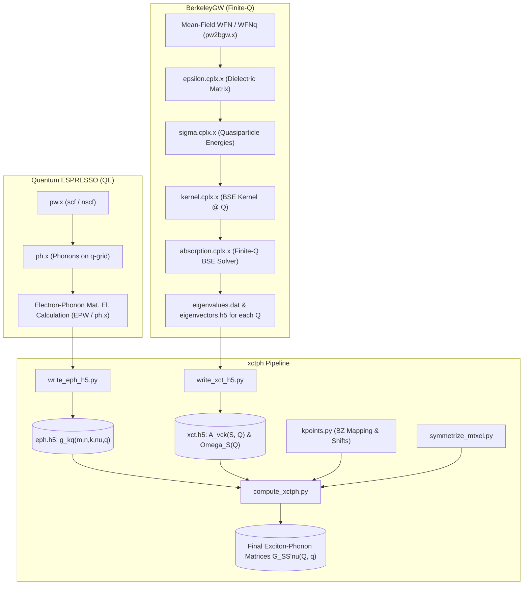

# Exciton-Phonon Coupling (`xctph`) Pipeline: Architecture & Code Audit

This document provides a comprehensive technical overview and audit of the exciton-phonon coupling pipeline, tracing the theory, data flow, BerkeleyGW/Quantum ESPRESSO upstream calculations, and the Python post-processing scripts in this workspace.

---

## Table of Contents
1. [Theoretical Formulation](#1-theoretical-formulation)
2. [End-to-End Pipeline Workflow](#2-end-to-end-pipeline-workflow)
3. [Upstream BerkeleyGW Finite-Momentum Specifics](#3-upstream-berkeleygw-finite-momentum-specifics)
   - [BSE with Finite Center-of-Mass Momentum $\mathbf{Q}$](#bse-with-finite-center-of-mass-momentum-mathbfq)
   - [The Finite-$\mathbf{Q}$ Double-Shift Bug (`qfix`)](#the-finite-mathbfq-double-shift-bug-qfix)
4. [Detailed Python Codebase Walkthrough](#4-detailed-python-codebase-walkthrough)
   - [`write_eph_h5.py`](#write_eph_h5py)
   - [`write_xct_h5.py`](#write_xct_h5py)
   - [`kpoints.py`](#kpointspy)
   - [`compute_xctph.py`](#compute_xctphpy)
   - [`symmetrize_mtxel.py` & `units.py`](#symmetrize_mtxelpy--unitspy)
5. [Comparison: Modified Workspace vs. Original Reference Scripts](#5-comparison-modified-workspace-vs-original-reference-scripts)
6. [Known Edge Cases, Subtleties, and Recommendations](#6-known-edge-cases-subtleties-and-recommendations)

---

## 1. Theoretical Formulation

The exciton-phonon coupling matrix element $G_{S S' \nu}(\mathbf{Q}, \mathbf{q})$ describes the transition amplitude between an initial exciton state $|S, \mathbf{Q}\rangle$ and a final exciton state $|S', \mathbf{Q}+\mathbf{q}\rangle$ mediated by a phonon mode $\nu$ at wavevector $\mathbf{q}$.

An exciton state $|S, \mathbf{Q}\rangle$ is expanded in electron-hole pairs:
$$|S, \mathbf{Q}\rangle = \sum_{v c \mathbf{k}} A_{v c \mathbf{k}}^S(\mathbf{Q}) \, c_{c, \mathbf{k}+\mathbf{Q}}^\dagger c_{v, \mathbf{k}} |0\rangle$$

where:
- $\mathbf{Q}$ is the exciton center-of-mass momentum.
- $\mathbf{k}$ is the hole momentum; $\mathbf{k}+\mathbf{Q}$ is the electron momentum.
- $A_{v c \mathbf{k}}^S(\mathbf{Q})$ are the exciton envelope amplitudes obtained by solving the finite-$\mathbf{Q}$ Bethe-Salpeter equation (BSE).
- $v, c$ are valence and conduction band indices, respectively.

In the Tamm-Dancoff approximation (TDA), the exciton-phonon matrix element separates into an **electron scattering channel** and a **hole scattering channel**:

$$G_{S S' \nu}(\mathbf{Q}, \mathbf{q}) = G_{S S' \nu}^{(e)}(\mathbf{Q}, \mathbf{q}) - G_{S S' \nu}^{(h)}(\mathbf{Q}, \mathbf{q})$$

### Electron Channel:
The phonon scatters the electron from conduction state $c \to d$ at momentum $\mathbf{k}+\mathbf{Q} \to \mathbf{k}+\mathbf{Q}+\mathbf{q}$, with the hole state $v$ at $\mathbf{k}$ acting as a spectator:
$$G_{S S' \nu}^{(e)}(\mathbf{Q}, \mathbf{q}) = \sum_{v c d \mathbf{k}} \left[ A_{v d (\mathbf{k}+\mathbf{q})}^{S'}(\mathbf{Q}+\mathbf{q}) \right]^* g_{c d \nu}^{(e)}(\mathbf{k}+\mathbf{Q}, \mathbf{q}) \, A_{v c \mathbf{k}}^S(\mathbf{Q})$$
*(Note: With appropriate origin conventions, $g_{c d \nu}^{(e)}$ is evaluated with incoming electron momentum).*

### Hole Channel:
The phonon scatters the hole from valence state $v \to w$, with the electron state $c$ acting as a spectator. Because creating a hole state corresponds to removing an electron, a minus sign arises from fermion exchange, along with complex conjugation and momentum inversion:
$$G_{S S' \nu}^{(h)}(\mathbf{Q}, \mathbf{q}) = \sum_{v w c \mathbf{k}} \left[ A_{w c (\mathbf{k}+\mathbf{q})}^{S'}(\mathbf{Q}+\mathbf{q}) \right]^* g_{w v \nu}^{(h)}(\mathbf{k}-\mathbf{Q}, \mathbf{q}) \, A_{v c \mathbf{k}}^S(\mathbf{Q})$$

---

## 2. End-to-End Pipeline Workflow



---

## 3. Upstream BerkeleyGW Finite-Momentum Specifics

### BSE with Finite Center-of-Mass Momentum $\mathbf{Q}$
When excitons carry non-zero center-of-mass momentum $\mathbf{Q}$:
1. The hole is at $\mathbf{k}$ and the electron is at $\mathbf{k}+\mathbf{Q}$.
2. The kinetic energy difference between the single-particle quasiparticle states is:
   $$\Delta E_{vc\mathbf{k}}(\mathbf{Q}) = E_c(\mathbf{k}+\mathbf{Q}) - E_v(\mathbf{k})$$
3. The electron-hole interaction kernel $K_{vc\mathbf{k}, v'c'\mathbf{k}'}(\mathbf{Q})$ has direct screened Coulomb attraction ($W$) and exchange repulsion ($V$).
4. The output eigenvectors store $A_{v c \mathbf{k}}^S(\mathbf{Q})$. In BGW HDF5 output, datasets contain real and imaginary components over $(v, c, \mathbf{k})$.

### The Finite-$\mathbf{Q}$ Double-Shift Bug (`qfix`)
- **Stock BerkeleyGW 4.0 issue:** An indexing mismatch existed in the finite-$\mathbf{Q}$ quasiparticle energy shift routine. When constructing the diagonal matrix elements $\Delta E_{vc\mathbf{k}}(\mathbf{Q})$, the valence band was inadvertently shifted or evaluated with an extraneous momentum shift, causing a double-count of the $\mathbf{Q}$-shift on the energy differences.
- **The Fix (`BerkeleyGW-4.0-finiteq-qfix`):** Restores the proper momentum evaluation $E_c(\mathbf{k}+\mathbf{Q}) - E_v(\mathbf{k})$ without shifting the valence state $\mathbf{k}$.
- **Implication for existing runs:** Any finite-$\mathbf{Q}$ datasets produced with the unpatched binary contain shifted resonance poles and modified mixing coefficients in $A_{vc\mathbf{k}}^S(\mathbf{Q})$.

---

## 4. Detailed Python Codebase Walkthrough

### `write_eph_h5.py`
- **Purpose:** Ingests raw electron-phonon matrix elements from QE/EPW text/binary formats and structures them into a standard HDF5 schema (`eph.h5`).
- **Data Structure:**
  - `gkq`: Array of shape `(nbnd, nbnd, nk, nmodes, nq)`, complex numbers storing $\langle n, \mathbf{k}+\mathbf{q} | \delta V_{\mathbf{q}\nu} | m, \mathbf{k} \rangle$.
  - `gkq_header/kpts`: Discrete grid of electronic $k$-points in crystal coordinates.
  - `gkq_header/qpts`: Discrete grid of phonon $q$-points in crystal coordinates.
  - `gkq_header/omega`: Phonon mode frequencies $\omega_{\mathbf{q}\nu}$.

### `write_xct_h5.py`
- **Purpose:** Gathers BSE solution files (`eigenvalues.dat` and `eigenvectors.h5`) across all finite-$\mathbf{Q}$ directories into a unified `xct.h5` container.
- **Key Operations:**
  - **Coordinate shift:** Sets `center_of_mass_Q = -1.0 * exciton_Q_shift` to align BGW momentum definitions with the electron-hole convention used downstream.
  - **Unit conversion:** Divides BGW Rydberg eigenvalues by `ryd2ev` (13.605693 eV/Ry) to store energies in eV.
  - **Memory Optimization (Chunked Storage):** Rather than loading the entire 6D tensor into RAM, it streams each $\mathbf{Q}$-point directly into an HDF5 dataset:
    ```python
    dset_evecs[0, :, :, :, :, iQ] = evecs_re + 1j * evecs_im
    ```
    Shape: `(ns, nv, nc, nk, nevecs, nQ)`.

### `kpoints.py`
- **Purpose:** Handles reciprocal space geometry and grid point lookup under periodic boundary conditions.
- **Key Functions:**
  - `k_to_cryst` / `cryst_to_k`: Transforms Cartesian reciprocal vectors $\leftrightarrow$ fractional coordinates using the reciprocal lattice matrix:
    $$b = 2\pi (a^{-1})^T$$
  - `wrap_kpts`: Folds arbitrary fractional coordinates back into the first Brillouin zone $[ -0.5, 0.5 )$.
  - `find_kpt`: Performs nearest-neighbor KD-tree or distance search with tolerance `1e-4` to map $(\mathbf{k}+\mathbf{q})$ or $(\mathbf{k}-\mathbf{Q})$ back to an integer index in the grid.
  - Returns `-1` if no matching point is found within tolerance.

### `compute_xctph.py`
- **Purpose:** Assembles the final exciton-phonon scattering matrix $G_{S S' \nu}(\mathbf{Q}, \mathbf{q})$ by contracting exciton eigenvectors with el-ph matrix elements.
- **Workflow:**
  1. Computes the grid shift mappings:
     - `k_plus_q_map[:, iq]`: maps $\mathbf{k} \to \mathbf{k}+\mathbf{q}$.
     - `k_minus_Q_map[:, iQ]`: maps $\mathbf{k} \to \mathbf{k}-\mathbf{Q}$.
     - `find_kpt` maps $\mathbf{Q}+\mathbf{q}$ to index `iQ_plus_q`.
  2. Subsets active valence and conduction bands:
     ```python
     nv = 6; nc = 6
     vb = slice(0, nv)
     cb = slice(nv, nv + nc)
     ```
  3. **Vectorized Contractions:**
     - **Electron Scattering:**
       ```python
       # aQq_e: (nv, nc, nk, nS_final) at (k + q, Q + q)
       # gkq_e: (nc, nc, nk, nmodes) at (k, q)
       # aQ_e:  (nv, nc, nk, nS_initial) at (k, Q)
       gQq[iQ, iq, :, :, :] += np.einsum(
           'vckm,cdkn,vdkb->mbn',
           aQq_e.conj(), gkq_e, aQ_e,
           optimize=True
       )
       ```
     - **Hole Scattering:**
       ```python
       # aQq_h: (nv, nc, nk, nS_final) at (k + q, Q + q)
       # gkq_h_flipped: reversed valence subspace at (k - Q, q)
       # aQ_h:  (nv, nc, nk, nS_initial) at (k + q, Q)
       gQq[iQ, iq, :, :, :] -= np.einsum(
           'vckm,wvkn,wckb->mbn',
           aQq_h.conj(), gkq_h_flipped, aQ_h,
           optimize=True
       )
       ```

### `symmetrize_mtxel.py` & `units.py`
- Auxiliary modules defining physical conversion constants (Bohr to Ångström, Ry to eV, Hartree to eV) and applying point-group symmetry operations to matrices.

---

## 5. Comparison: Modified Workspace vs. Original Reference Scripts

| File | Status | Modifications & Physical Impact |
| :--- | :--- | :--- |
| [`kpoints.py`](file:///projectnb/fpmats/samson/phonon_project/naphthelene/05-xctph-full/kpoints.py) | **Identical** | No changes. Same reciprocal tolerance (`1e-4`) and zone-wrapping logic. |
| [`write_eph_h5.py`](file:///projectnb/fpmats/samson/phonon_project/naphthelene/05-xctph-full/write_eph_h5.py) | **Identical** | No changes. Standard dataset format. |
| [`symmetrize_mtxel.py`](file:///projectnb/fpmats/samson/phonon_project/naphthelene/05-xctph-full/symmetrize_mtxel.py) | **Identical** | No changes. |
| [`units.py`](file:///projectnb/fpmats/samson/phonon_project/naphthelene/05-xctph-full/units.py) | **Identical** | Standard constants. |
| [`write_xct_h5.py`](file:///projectnb/fpmats/samson/phonon_project/naphthelene/05-xctph-full/write_xct_h5.py) | **Modified** | **Streaming I/O:** Original read all files into monolithic RAM arrays before writing. Workspace version creates chunked HDF5 datasets and writes slice-by-slice per $\mathbf{Q}$. **Physics is identical.** Header consistency assertions across different Qs were condensed. |
| [`compute_xctph.py`](file:///projectnb/fpmats/samson/phonon_project/naphthelene/05-xctph-full/compute_xctph.py) | **Modified** | 1. **Vectorization:** Replaced 4 nested loops over `ik` with BLAS/GEMM-accelerated `np.einsum`. Contractions match index-for-index.<br>2. **Band Truncation:** Hardcoded to `nv = 6`, `nc = 6` (12 active bands total).<br>3. **Guard Clause:** Added `if iQ_plus_q == -1: continue` to avoid out-of-grid index wrap. |

---

## 6. Known Edge Cases, Subtleties, and Recommendations

1. **Negative Index Trapping in NumPy:**
   - In `kpoints.py`, `find_kpt` returns `-1` when a shifted point cannot be found.
   - In `compute_xctph.py`, `if iQ_plus_q == -1: continue` protects the outer $\mathbf{Q}+\mathbf{q}$ lookup.
   - However, for `ik_plus_q = k_plus_q_map[:, iq]` and `ik_minus_Q = k_minus_Q_map[:, iQ]`, if any $k$-point was missed, NumPy's index `-1` silently references the *last element* of the array rather than throwing an error.
   - *Recommendation:* Add `assert not np.any(k_plus_q_map == -1)` and `assert not np.any(k_minus_Q_map == -1)` before contracting.

2. **Truncation Assumption (`nv = 6, nc = 6`):**
   - `cb = slice(nv, nv + nc)` assumes `gkq` in `eph.h5` contains at least 12 bands, and that the first 6 valence and first 6 conduction bands match the BSE transition subspace.
   - *Recommendation:* Add validation check verifying that `eph.h5` band ordering and indices align with BSE energy windows.

3. **Incomplete $\mathbf{Q}+\mathbf{q}$ Grid Coverage:**
   - If `iQ_plus_q == -1` triggers, the pair coupling is skipped and remains zero in `gQq`. If the $\mathbf{Q}$-grid does not close under addition with $\mathbf{q}$, matrix elements on boundary points will silently vanish.
   - *Recommendation:* Print a summary count of skipped $(\mathbf{Q}, \mathbf{q})$ pairs to confirm whether the grid is closed.

4. **BerkeleyGW Upstream Finite-$\mathbf{Q}$ Bug:**
   - As established in earlier audits, the unpatched finite-momentum binary causes an erroneous valence band shift. Ensure any production calculations are rerun with `BerkeleyGW-4.0-finiteq-qfix`.
