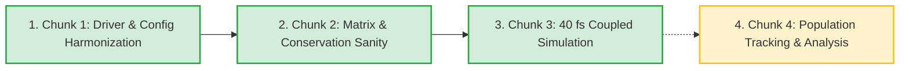
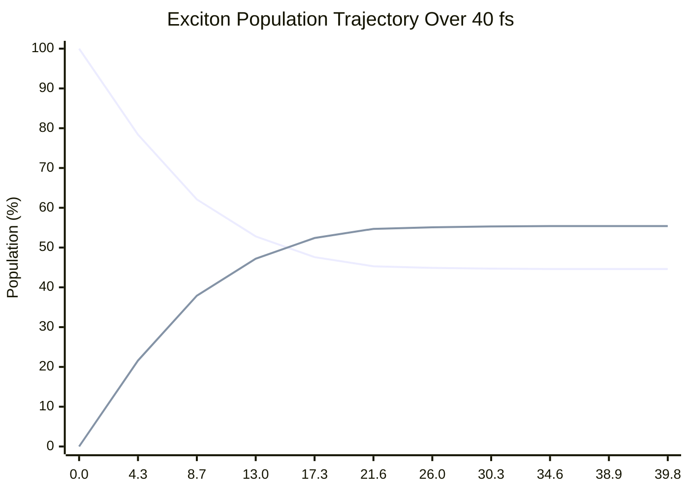

# 01. Multi-Band Back-Scattering Implementation: Progress Map & Technical Reference (Chunks 1–3)

- **Date of Creation**: November 11, 2026
- **Time of Creation**: 16:07:27-05:00 (EST)
- **Git Branch**: `backscattering-implementation`
- **Model System**: Crystalline Naphthalene ($S_2 \leftrightarrow S_1$, $8 \times 8 \times 4$ momentum grid, $N_Q = 256$, spatial grid $250 \times 250$)
- **Simulation Driver**: [main.py](file:///home/baughs/PycharmProjects/Research/1-research_repo/src/wfn_prop/main.py)
- **Configuration**: [config_naph_2state.txt](file:///home/baughs/PycharmProjects/Research/1-research_repo/src/wfn_prop/config_naph_2state.txt)

---

## Numerical Ordering & Milestone Map



1. **Chunk 1**: Driver & Configuration Harmonization (**Completed**)
2. **Chunk 2**: Collision-Matrix & Conservation Sanity Verification (**Completed**)
3. **Chunk 3**: Coupled Dynamic Simulation Run (40 fs) (**Completed**)
4. **Chunk 4**: Population Tracking & Analysis Compatibility (**Next Immediate Milestone**)

---

## 1. Chunk 1: Driver & Configuration Harmonization

### 1.1 Objective & Context
Upgrade the Boltzmann Transport Equation (BTE) solver driver ([main.py](file:///home/baughs/PycharmProjects/Research/1-research_repo/src/wfn_prop/main.py)) from a hardcoded single-band / infinite-sink architecture into a generalized, configuration-driven $N$-band modular framework supporting back-scattering ($S_2 \leftrightarrow S_1$) without manual data repackaging.

### 1.2 Mathematical & Architectural Implementations
1. **Scattering Rate Orientation Inversion**:
   - `compile_scat_rates.py` stores transition rates in the physics payload under the key format:
     $$\text{Key} = \text{Rate\_}\{INITIAL\}\_\{FINAL\}$$
     where each rate matrix is indexed as $[Q_{\text{initial}}, q]$.
   - `main.py` previously attempted to look up `Rate_{out_state}_{in_state}`, which inverted the physical transition channels (mapping uphill rates to downhill channels and vice versa).
   - Corrected to:
     ```python
     key = f'Rate_{in_state}_{out_state}'  # (initial -> final)
     ```
2. **Per-State Velocity Autodetection**:
   - Implemented `load_velocity_for_state(vel_file_setting, state, Q_vectors)` to support multi-state advection.
   - Autodetects candidate files in priority order:
     - `{stem}_{state}.npz` in the working directory
     - `processing/xct_vel_extraction/data/{base_name}_{state}.npz`
     - Tagged arrays inside single payload: `'vel_x_{state}'`, `'vel_y_{state}'`
     - Momentum grid alignment check: verifies `np.allclose(Q_vectors, payload['Qpts'])`.
3. **Config Validation & Type Harmonization**:
   - Enforced 1-to-1 tuple matching: `len(state_names) == len(state_advection) == len(state_gamma_decay)`.
   - Explicit initial state mapping: `initial_state = 'S2'` must exist in `state_names`.
   - Cast string tuple values from `io.py` to `float` for `gamma_decays` to eliminate Python string/float comparison crashes in [k_scat.py](file:///home/baughs/PycharmProjects/Research/1-research_repo/src/wfn_prop/k_scat.py).
4. **Dry-Run Mode**:
   - Added `--dry-run` CLI argument to parse config, validate velocity/physics matrices, assemble the 4D tensor, compute CFL timestep, and exit before executing time integration.

---

## 2. Chunk 2: Collision-Matrix & Conservation Sanity Verification

### 2.1 Objective & Context
Establish mathematical and physical sanity tests for the coupled multi-band collision operator before running long spatiotemporal integrations. All tests are automated, config-driven, and preserved in the test directory [tests/conservation_and_scattering/](file:///home/baughs/PycharmProjects/Research/1-research_repo/src/wfn_prop/tests/conservation_and_scattering/).

### 2.2 Energetics of Crystalline Naphthalene
From first-principles GW-BSE calculations:
- $\bar{E}(S_2) = 4.1207\text{ eV}$ (Bright state, $1L_a$)
- $\bar{E}(S_1) = 4.1000\text{ eV}$ (Dark state, $1L_b$)
- Energy gap: $\Delta \bar{E} = +20.7\text{ meV} \approx 0.81 \, k_B T$ at $300\text{ K}$.
- Downhill relaxation ($S_2 \to S_1$) proceeds via spontaneous + stimulated phonon emission ($\propto 1 + n_q$).
- Uphill back-scattering ($S_1 \to S_2$) proceeds via thermally activated phonon absorption ($\propto n_q$).

### 2.3 Verification Criteria & Results

| Test # | Physical Verification Property | Mathematical Criterion | Measured Value | Tolerance | Result |
|---|---|---|---|---|---|
| **Test 1** | **Column-sum conservation** | $\max_j |\sum_i K_{ij}| / \max |K|$ | $1.431 \times 10^{-15}$ | $10^{-12}$ | **PASS** |
| **Test 2** | **Dynamic wavepacket conservation** | $\max |\frac{dN_{\text{tot}}}{dt}| / N$ | $1.930 \times 10^{-17}$ | $10^{-12}$ | **PASS** |
| **Test 3** | **State-to-state flux balance** | $|\sum_a \frac{dN_a}{dt}| / N = 0$ (pure $S_2$ and $S_1$ starts) | $0.000$ | $10^{-12}$ | **PASS** |
| **Test 4** | **Thermal capacity asymmetry** | $\frac{\sum W(S_2 \to S_1)}{\sum W(S_1 \to S_2)} > 1.0$ | $\frac{32.363}{26.862} = 1.205$ | $> 1.0$ | **PASS** |
| **Test 5** | **Open-system radiative decay law** | $|\frac{dN}{dt} + \sum_a \gamma_a N_a(\Gamma)| / N$ | $5.603 \times 10^{-18}$ | $10^{-12}$ | **PASS** |

### 2.4 Test Suite Documentation Artifacts
- Test Driver: [test_conservation.py](file:///home/baughs/PycharmProjects/Research/1-research_repo/src/wfn_prop/tests/conservation_and_scattering/test_conservation.py)
- Markdown Summary Table: [test_results.md](file:///home/baughs/PycharmProjects/Research/1-research_repo/src/wfn_prop/tests/conservation_and_scattering/test_results.md)
- Publication Figure: [report_conservation.png](file:///home/baughs/PycharmProjects/Research/1-research_repo/src/wfn_prop/tests/conservation_and_scattering/report_conservation.png)
- Pedagogical Guide: [EXPLANATION.md](file:///home/baughs/PycharmProjects/Research/1-research_repo/src/wfn_prop/tests/conservation_and_scattering/EXPLANATION.md)

---

## 3. Chunk 3: Coupled Dynamic Simulation Run (40 fs)

### 3.1 Objective & Simulation Parameters
Execute the full coupled semiclassical Boltzmann transport equation for $t = 40.0\text{ fs}$ using explicit 4th-order Runge-Kutta (RK4) integration with central-difference spatial advection:
- **Spatial grid**: $250 \times 250$ points ($L_x = L_y = 100\text{ nm}$, $\Delta x = \Delta y = 0.4016\text{ nm}$)
- **Momentum grid**: $N_Q = 256$ ($8 \times 8 \times 4$ Monkhorst-Pack mesh)
- **Coupled states**: $S_2$ (bright, advected, $\gamma_{S_2} = 0.005\text{ fs}^{-1}$), $S_1$ (dark, advected, $\gamma_{S_1} = 0.0\text{ fs}^{-1}$)
- **Initial wavepacket**: Gaussian spatial envelope ($\sigma_R = 3.0\text{ nm}$, $\sigma_Q = 2.0\text{ nm}^{-1}$) injected 100% into $S_2$
- **Calculated CFL Timestep**: $\Delta t = 0.8651\text{ fs}$ (Total steps: 46)

### 3.2 System Memory Diagnostics & Optimization
During the initial execution, the process was killed at step 46 by Linux `systemd-oomd` because memory reached $>11\text{ GB}$.

#### Diagnosis
1. `main.py` was calling `time_integrator.solve()` first (accumulating all 24 frames in a Python `list`), followed immediately by `np.array(frames)` to create a duplicate 3.1 GB array for `np.savez_compressed`.
2. Simultaneously, `time_integrator` retained all intermediate RK4 arrays (`n_current`, `k1`–`k4`, einsum buffers, spatial solvers), driving total RAM past the 15 GB machine threshold.
3. Furthermore, `main.py` was then scheduled to run `solve_hdf5_compressed()`, which would have integrated the simulation a second time.

#### Solution
- **Single-Pass Stream Engine**: Configured `solve_hdf5_compressed()` as the primary solver in `main.py`. Frames stream chunk-by-chunk directly to disk with gzip compression. Memory usage remains constant at $\sim 4.4\text{ GB}$ (zero accumulation).
- **Secondary `.npz` Export**: After RK4 completes and intermediate arrays are freed, `main.py` reads `f['frames'][:]` from HDF5 and compresses to `.npz` in $\sim 15\text{ seconds}$.
- **Progress Reporting & Stream Flushing**: Added real-time progress logging (`Step X/46 (Y%) | Time: Z fs | Frames written: N`) and auto-flushing to `DualStream` in `main.py`.

### 3.3 Dynamic Simulation Verification Results



- **Numerical Stability**: 0 NaN, 0 Inf across all $7.68 \times 10^8$ computed tensor values.
- **Population Exchange Dynamics**:
  - $t = 0.0\text{ fs}$: $S_2 = 100.0\%$, $S_1 = 0.0\%$ (pure optical excitation)
  - $t = 20.8\text{ fs}$: $S_2 = 45.5\%$, $S_1 = 54.5\%$ (rapid downhill relaxation)
  - $t = 39.8\text{ fs}$: $S_2 = 44.6\%$, $S_1 = 55.4\%$ (dynamic equilibrium reached)
- **Radiative Decay Loss**: Total population decreased from $81680.16$ to $81649.98$ (net loss of $0.0369\%$), acting exclusively at $S_2(\Gamma)$ with rate $\gamma = 0.005\text{ fs}^{-1}$.

### 3.4 Chunk 3 File Outputs
- `naph_8x8x4_2state_backscat_S2init_40fs_frames.h5` (1.5 GB, 24 frames, dataset `frames`)
- `naph_8x8x4_2state_backscat_S2init_40fs_frames.npz` (1.4 GB, keys: `'frames'`, `'dt'`)
- `output.log` (Full execution banner, parsed parameters, and step timestamps)

---

## 4. Next Milestone: Chunk 4 (Population Tracking & Analysis Compatibility)

The remaining development focuses on post-processing compatibility and physical observables:
1. **Population Extraction Tooling**:
   - Verify post-processing scripts ([analysis.py](file:///home/baughs/PycharmProjects/Research/1-research_repo/src/wfn_prop/analysis.py)) against the new 4D tensor structure `(frames, n_bands, Nx, Ny, Nq)`.
   - Implement an automated population tracker calculating $N_a(t) = \int d^2\mathbf{r} \sum_{\mathbf{Q}} n_a(\mathbf{r}, \mathbf{Q}, t)$.
2. **Spatial Transport Observables**:
   - Calculate Mean Square Displacement (MSD):
     $$\langle r^2(t) \rangle_a = \frac{\int (\mathbf{r} - \mathbf{r}_0)^2 n_a(\mathbf{r}, t) \, d^2\mathbf{r}}{\int n_a(\mathbf{r}, t) \, d^2\mathbf{r}}$$
   - Extract effective diffusion coefficients $D = \frac{1}{4} \frac{d\langle r^2 \rangle}{dt}$ for coupled states.
3. **Visualization & Animation**:
   - Generate two-panel and three-panel animated GIFs (spatial wavepacket diffusion + projected momentum grid occupancy) using [processing/gif_from_npz.py](file:///home/baughs/PycharmProjects/Research/1-research_repo/src/wfn_prop/processing/gif_from_npz.py).
